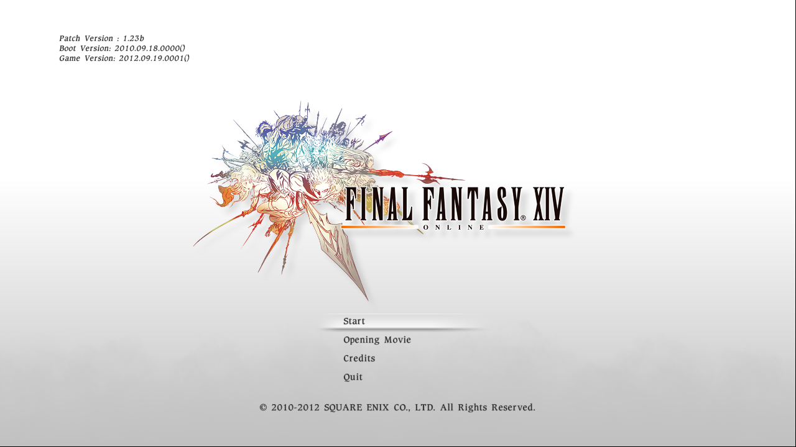

# ffxiv-123b-macOS

FINAL FANTASY XIV 1.23b (the original 1.0 client, `ffxivgame.exe` 2012.09.19.0001) running
natively on Apple silicon Macs, with no Wine or Rosetta. The game's 32-bit x86 executable is
statically translated to C on your own machine, from your own install, and built as an arm64 macOS
binary on top of a platform layer written for macOS: Win32, Direct3D 9 on Metal, XAudio2, input
and Winsock.



It connects to private servers: [Project Meteor](https://github.com/Ioncannon/project-meteor-server),
[Bahamut](https://github.com/BahamutXIV/bahamut-launcher) and [Garlemald](https://github.com/swstegall/Garlemald-Server).

## How it works

- `recomp/` — the static recompiler: every function of the original executable becomes a C function
  `f_XXXXXXXX` (its address) taking `Guest* g`. SSE/SSE2/MMX and x87 are translated; switch tables
  and tail jumps come from the metadata.
- `meta/ffxivgame.1.23b.meta.json` — function ranges, switch tables and tail jumps for 1.23b,
  exported from a Ghidra analysis, keyed by the SHA-256 of `ffxivgame.exe`. Addresses and shapes
  only.
- `meta/ffxivgame.1.23b.apply.json` — small code patches translated into the game (the same ones the
  Garlemald launcher applies to the file, plus a few host hooks such as the frame-rate target).
- `runtime/` — the guest machine (registers, memory at host `0x20000000000 + VA`, threads, fibers) and
  `runtime/portable/`, the Win32/D3D9/XAudio2/Winsock shims. Direct3D 9 runs on Metal; the window
  and input go through SDL3.
- `tests/xivboot.c` — the host that loads the translation and starts the game.

## Requirements

- An Apple silicon Mac, Xcode command-line tools, Python 3.
- Your own retail FINAL FANTASY XIV install, patched to 1.23b (for example with
  [XIV-1.0-Apple-Silicon-Installer](https://github.com/swstegall/XIV-1.0-Apple-Silicon-Installer)
  and [Garlemald Client](https://github.com/swstegall/Garlemald-Client) or [Bahamut Launcher](https://github.com/BahamutXIV/bahamut-launcher). The build reads
  `ffxivgame.exe` and the game data from it.
- A running 1.23b server.

## Build

```sh
python3 -m venv .venv && .venv/bin/pip install pycryptodome
.venv/bin/python tools/build_xiv.py translate --exe /path/to/ffxivgame.exe
.venv/bin/python tools/build_xiv.py xivboot   --exe /path/to/ffxivgame.exe
```

`translate` writes the generated C to `generated/ffxivgame/` (gitignored); `xivboot` builds
`build/xivboot`. A debug build for lldb: add `--debug [--opt -O0]` (→ `build/xivboot-dbg`, see
`tools/xivdbg.sh` and `tools/lldb/xiv_lldb.py`).

## Play

```sh
.venv/bin/python tools/xiv_login.py --meteor --server http://127.0.0.1:8000 --user NAME \
    --game "/path/to/FINAL FANTASY XIV"
```

`xiv_login.py` signs in through the server's web login (Project Meteor's PHP pages with `--meteor`,
Bahamut's format with `--bahamut`, or Garlemald's front end otherwise; `--signup` creates the account
first), then starts the game with the session. The password is asked for on the terminal (or read
from `XIV_PASSWORD`) and only sent to `--server`. You can set an alternate lobby endpoint via the CLI
by passing `--lobby`. For example, on the public Bahamut server, you can login with:

```sh
.venv/bin/python tools/xiv_login.py --bahamut --server https://bahamut.stegall.me:443 --lobby bahamut.stegall.me \
--user NAME --game "/path/to/FINAL FANTASY XIV"
```

Useful environment switches: `XIV_SERIAL=1` (guest threads take turns), `FFXI_RECOMP_TRACE=1`
(log every shim call), `XIV_SAMPLE=<file>` (sampling profiler, report with `tools/xiv_sample.py`).
A call into untranslated code stops with `[recomp] FATAL at <addr>` plus registers and the guest
stack.

## Rules

- **No Square Enix bytes in this repo, ever.** No executables, no DLLs, no game data and **no
  generated C**: generated code is derived from the game, so it is produced on the player's own
  machine from their own install. `.gitignore` enforces the obvious paths; the rule applies
  everywhere.
- What is committed: the recompiler, the runtime, the platform layer, tests and per-build
  metadata (addresses and shapes only).

## Lineage

The recompiler and much of the runtime come from
[xi-on-anything](https://github.com/rubymatrix/xi-on-anything), the same approach applied to
FINAL FANTASY XI; some of its FFXI-specific files are still in this tree.

## License

MIT (see `LICENSE`). Third-party code under `third_party/` keeps its own licenses.
FINAL FANTASY is a registered trademark of Square Enix Holdings Co., Ltd. This project is not
affiliated with or endorsed by Square Enix.
