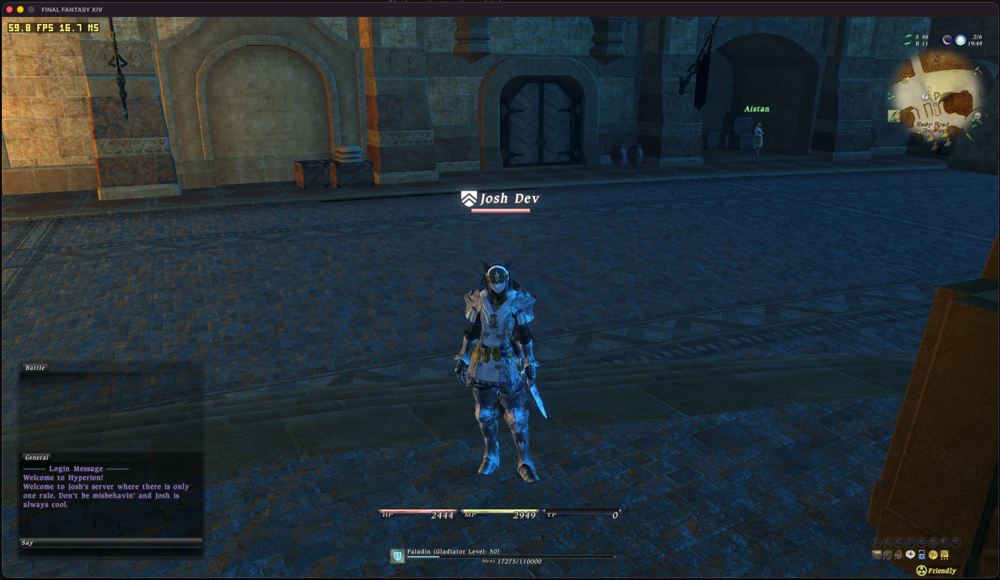

# ffxiv-123b-macOS



FINAL FANTASY XIV 1.23b (the original 1.0 client) running natively on Apple silicon Macs. No Wine,
no Rosetta.

The game's 32-bit x86 executable is statically translated to C on your machine, from your own
install, and compiled as an arm64 macOS app. Windows, Direct3D 9, audio, input and networking are
replaced by a macOS platform layer (Direct3D 9 runs on Metal).

It connects to 1.23b private servers such as
[Project Meteor](https://github.com/Ioncannon/project-meteor-server).

## Requirements

- Apple silicon Mac, Xcode command-line tools, Python 3
- Your own FINAL FANTASY XIV install patched to 1.23b
- A running 1.23b server

## Build

```sh
python3 -m venv .venv && .venv/bin/pip install pycryptodome
.venv/bin/python tools/build_xiv.py translate --exe /path/to/ffxivgame.exe
.venv/bin/python tools/build_xiv.py xivboot   --exe /path/to/ffxivgame.exe
```

This produces `build/xivboot`.

## Play

```sh
.venv/bin/python tools/xiv_login.py --meteor --server http://127.0.0.1:8000 --user NAME \
    --game "/path/to/FINAL FANTASY XIV"
```

Signs in through the server's web login and starts the game.

## No game files here

This repo contains no Square Enix code or data, and never will. The translated C is generated
locally from your own copy of the game and is not committed.

## Credits

The recompiler and runtime come from
[xi-on-anything](https://github.com/rubymatrix/xi-on-anything), the same approach applied to
FINAL FANTASY XI.

## License

MIT (see `LICENSE`). FINAL FANTASY is a registered trademark of Square Enix Holdings Co., Ltd.
This project is not affiliated with or endorsed by Square Enix.
